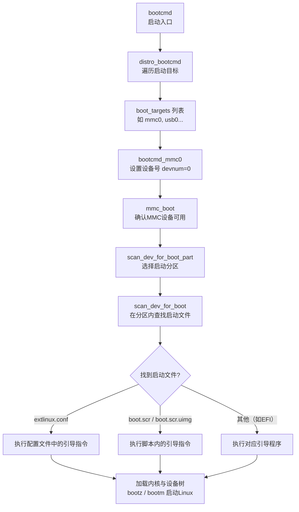

# sunxi8ia33
## gameshell kit's cpu， Allwinner R16:
1. quad-core Cortex-a7
2. mail400mp2 gpu, support opengl es 2.0 / openvg 1.1
3. sdram 1GB
3. sd and emmc
4. a33 is r16, there is no difference between them
5. ...

# kernel
1. linux-5.4.16
2. git apply cpi-5.4.16.patch
3. mkimage -A arm -O linux -T kernel -C none -a 0x40008000 -e 0x40008000 -n "Linux kernel" -d arch/arm/boot/zImage uImage

# uboot
1. u-boot v2026.10
2. A33-OLinuXino_defconfig -> gameshell_sunxi8i_a16_defconfig
3. sun8i-a33-olinuxino.dts
4. bootcmd:
- bootcmd=run distro_bootcmd
    - distro_bootcmd=for target in \${boot_targets}; do run bootcmd_${target}; done
        - boot_targets=fel mmc0
- bootcmd_fel=if test -n ${fel_booted} && test -n \${fel_scriptaddr}; then echo '(FEL boot)'; source \${fel_scriptaddr}; fi
- bootcmd_mmc0=devnum=0; run mmc_boot
- mmc_boot=if mmc dev \${devnum}; then devtype=mmc; run scan_dev_for_boot_part; fi
- scan_dev_for_boot_part=
    ```bash
    if env exists distro_bootpart; then # distro_bootpart=null
        setenv devplist ${distro_bootpart};
    else
        part list ${devtype} ${devnum} -bootable devplist;
        env exists devplist || setenv devplist 1;
    fi;
    for distro_bootpart in ${devplist}; do
        if fstype ${devtype} ${devnum}:${distro_bootpart} bootfstype; then
            part uuid ${devtype} ${devnum}:${distro_bootpart} distro_bootpart_uuid;
            run scan_dev_for_boot;
        fi;
    done;
    setenv devplist
    ```
- scan_dev_for_boot=
    ```bash
    echo Scanning ${devtype} ${devnum}:${distro_bootpart}...; for prefix in ${boot_prefixes};
    do run scan_dev_for_extlinux; run scan_dev_for_scripts; done;run scan_dev_for_efi;
    ```
- scan_dev_for_extlinux
    ```bash
    if test -e ${devtype} ${devnum}:${distro_bootpart} ${prefix}${boot_syslinux_conf}; then echo Found ${prefix}${boot_syslinux_conf}; run boot_extlinux; echo EXTLINUX FAILED: continuing...; fi
    ```
- scan_dev_for_scripts
    ```bash
    for script in ${boot_scripts}; do if test -e ${devtype} ${devnum}:${distro_bootpart} ${prefix}${script}; then echo Found U-Boot script ${prefix}${script}; run boot_a_script; echo SCRIPT FAILED: continuing...; fi; done
    ```
    - ***boot_scripts=boot.scr.uimg boot.scr***
- scan_dev_for_efi
    ```bash
    setenv efi_fdtfile ${fdtfile}; if test -z "${fdtfile}" -a -n "${soc}"; then setenv efi_fdtfile ${soc}-${board}${boardver}.dtb; fi; for prefix in ${efi_dtb_prefixes}; do if test -e ${devtype} ${devnum}:${distro_bootpart} ${prefix}${efi_fdtfile}; then run load_efi_dtb; fi;done;run boot_efi_bootmgr;if test -e ${devtype} ${devnum}:${distro_bootpart} efi/boot/bootarm.efi; then echo Found EFI removable media binary efi/boot/bootarm.efi; run boot_efi_binary; echo EFI LOAD FAILED: continuing...; fi; setenv efi_fdtfile
    ```



# tool
1. toolchain 
- gcc-arm-11.2-2022.02-x86_64-arm-none-linux-gnueabihf(https://mirrors.tuna.tsinghua.edu.cn/armbian-releases/_toolchain/)
2. sunxi-tools
> FEL boot (USB OTG)
>> FEL is the name of the Allwinner defined USB boot protocol built in the
>> mask ROM of most Allwinner SoCs. It allows to bootstrap a board solely
>> by using the USB-OTG interface and a host port on another computer.
>> These tools include sunxi-bootinfo, sunx-fel, sunxi-fexc, sunxi-pio.
>> See also tools/sunxi/sunxi-tools-1.4/README.md
```bash
# use "sunxi-fel" to access the board, This should give you an output starting with: AWUSBFEX soc=00001667(A33)...
./sunxi-fel ver -v -p
# bootstrap U-Boot by just providing our venerable u-boot-sunxi-with-spl.bin
./sunxi-fel uboot u-boot-sunxi-with-spl.bin
```
3. wolfallein
- patch for kernel cpi-5.4.16.patch

# official
1. GameShell(https://github.com/clockworkpi/GameShell)

# backup
- backup files, such as boot and u-boot-sunxi-with-spl.bin, is published by official
- uboot/scripts/dtc/dtc -I dtb -O dts -o sun8i-r16-clockworkpi-cpi3.dts sun8i-r16-clockworkpi-cpi3.dtb

# output 
1. u-boot-sunxi-with-spl
> Transfer to an (micro)SD card (see below for more details)::
```bash
  $ sudo dd if=u-boot-sunxi-with-spl.bin of=/dev/sdX bs=8k seek=1
```
> Boot and enjoy!

> **note**::
  The traditional SD card location the Allwinner BootROM loads from is 8KB
  (sector 16). This works fine with the old MBR partitioning scheme, which most
  SD cards come formatted with. However this is in the middle of a potential
  GPT partition table, which will become invalid in this step. Newer SoCs
  (starting with the H3 from late 2014) also support booting from 128KB, which
  is beyond even a GPT and thus a safer location.
2. boot.cmd
- mkimage -A arm -O linux -T script -C none -a 0 -e 0 -n "My Boot Script" -d boot.cmd boot.scr